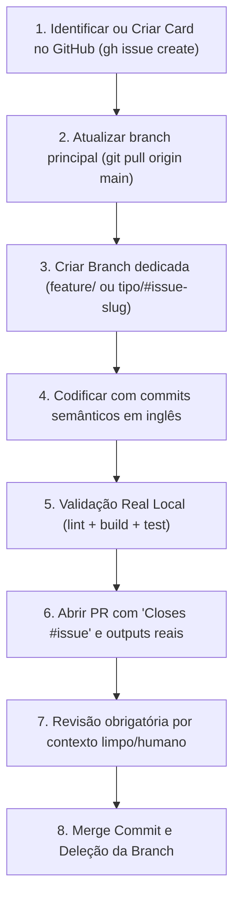

# AGENT.md — Regras de Governança e Código do repo decision-llm-simulator

> Aplica-se a **qualquer agente de IA ou desenvolvedor humano** que colabore neste repositório
> (Hermes, agy, OpenCode, Claude Code, Codex, humano).
> Este documento é o contrato técnico e operacional do repositório. As seções de fluxo, gestão de cards,
> stack e validação devem refletir o estado real verificado do projeto.

---

## Regra zero: nunca trabalhe direto na `main`

- A branch `main` é estritamente protegida e só recebe alterações via **Pull Request aprovado e mergeado**.
- **Commits diretos e push direto na `main` são expressamente proibidos.**
- **Única exceção** (embutida nesta regra, sem interpretações adicionais): correção pontual de typo em documentação ou revert emergencial de produção — ambos **devem** utilizar o tipo de commit correspondente (`docs:` ou `revert:`) e explicar a emergência detalhadamente no corpo do commit.
- Todo trabalho começa com uma branch dedicada a partir da `main` atualizada:
  - `feature/<name-of-feature>` ou `feat/#<issue>-<slug>` — nova funcionalidade
  - `fix/<slug>` ou `fix/#<issue>-<slug>` — correção de bug
  - `refactor/<slug>` ou `refactor/#<issue>-<slug>` — reestruturação interna sem alteração de comportamento
  - `docs/<slug>` — apenas alterações em documentação
  - `chore/<slug>` — tooling, CI, dependências, scripts de apoio
  - `test/<slug>` — criação ou ajuste de suítes de testes
  - `build/<slug>` — empacotamento, Docker, dependências de build
- **Branches de vida curta**: 1 branch = 1 card/issue = 1 Pull Request. Se uma branch começar a resolver dois problemas distintos, divida-a formalmente em duas.
- **Estratégia de Merge**: **merge commit** (preserva o histórico atômico). Não utilizar squash nem rebase merge, a menos que expressamente configurado no repositório.

---

## Regra Um: Gestão por Issues / Cards Obrigatória (Issue-Driven Development)

**Nenhuma nova implementação (feature, bugfix estrutural, refatoração arquitetural ou tarefa técnica) pode ser iniciada sem que exista um Card / Issue previamente criado no repositório.**

O desenvolvimento é 100% rastreável e orientado a cards. Isso assegura histórico, auditoria e alinhamento claro de escopo antes de qualquer linha de código.

### 1. Criação do Card / Issue antes de iniciar qualquer código

- Antes de criar a branch de trabalho ou modificar arquivos, verifique se a demanda já possui um card aberto.
- Caso não exista, crie-o imediatamente via GitHub CLI (`gh issue create`) ou pela interface web do repositório.
- Exemplo de comando via CLI:

```bash
gh issue create \
  --title "[Feat] Simulador de Modelo de Decisão com Ollama e Zod" \
  --body "## 1. Contexto e Objetivo\n...\n\n## 2. Escopo e Critérios de Aceite\n- [ ] Critério 1\n\n## 3. Plano Técnico\n...\n\n## 4. Plano de Validação\n..." \
  --label "enhancement"
```

### 2. Estrutura Padrão Obrigatória do Card / Issue

Todo card deve conter os seguintes tópicos obrigatórios:

1. **Título Padronizado**: Prefixo semântico em inglês (`[Feat]`, `[Fix]`, `[Refactor]`, `[Task]`, `[Chore]`).
2. **Contexto & Objetivo**: Por que essa mudança é necessária? Qual dor de negócio ou oportunidade técnica ela soluciona?
3. **Escopo & Critérios de Aceite**: Checklist objetivo com checkboxes (`- [ ]`) contendo os comportamentos verificáveis que definem a entrega. Declare também o que está explicitamente **Fora de Escopo**.
4. **Plano Técnico & Arquitetura**: Módulos, schemas Zod, contratos de API e modelos afetados.
5. **Plano de Validação**: Comandos exatos de build, lint, typecheck e testes automatizados que serão rodados para comprovar o funcionamento.

### 3. Vínculo Issue ⟷ Branch ⟷ Pull Request

- **Nome da Branch**: Nomeie a branch referenciando a convenção de feature ou identificador do card:
  - Formato: `feature/<name-of-feature>` ou `<tipo>/#<issue-id>-<slug>` (Ex: `feature/decision-llm-simulator` ou `feat/#1-decision-llm-simulator`).
- **Fechamento no PR**: O Pull Request deve obrigatoriamente referenciar o fechamento automático da issue em seu corpo:
  - `Closes #<issue-id>` (para features e tarefas)
  - `Fixes #<issue-id>` (para bugs)
- **Gestão de Bloqueios**: Se a especificação estiver ambígua ou surgirem impedimentos técnicos durante o desenvolvimento: **pare imediatamente, comente o bloqueio diretamente no card da Issue e aguarde esclarecimento do dono**. Decisões unilaterais de escopo são proibidas.

---

## Linguagem e Padrões do Projeto

- **Linguagem Padrão**: TypeScript (ESM, Node.js >= 22.x)
- **Convenção de Idiomas**:
  - **Idioma Oficial do Projeto**: **Português (pt-BR)** para documentação, cenários, CLI, prompts de decisão, feedbacks de auditoria, relatórios e comunicação geral.
  - Identificadores técnicos de código (nomes de funções, interfaces e schemas Zod) mantêm compatibilidade TypeScript idiomática.
- **Dependências**: Prefira bibliotecas padronizadas, ativamente mantidas e leves. Zero dependência supérflua sem justificativa expressa no card.

### Diretrizes Arquiteturais Preferidas pelo Dono

- **Validação & Schemas**: Zod (v3.x) para validação estruturada, constraints e parsing de outputs LLM.
- **ORM / Banco de Dados**: Stateless / File-based JSON & Markdown Storage (reports/ e scenarios/).
- **Mensageria & Filas**: Node.js Async EventEmitter & Simulation Event Bus.
- **Cache & Armazenamento Temporário**: In-Memory TTL Cache para chamadas LLM e execuções repetidas.
- **Storage de Objetos**: Local filesystem (`scenarios/`, `reports/`, `simulations/`).
- **Orquestração de Agentes / IA**: Ollama API Client com Zod Structured Outputs, Decision Policies e fallback resiliente.

---

## Stack Deste Repositório (Verificada em 2026-10-15)

- **Runtime / Ambiente**: Node.js >= 22.x (ESM nativo)
- **Gerenciador de Pacotes**: npm
- **Web / API Framework**: TypeScript Modular Core Engine & CLI (Commander, Inquirer, Chalk)
- **Banco de Dados & Migrations**: N/A (Evolução de esquemas via Zod Schemas e JSON fixtures)
- **Test Runner**: Vitest
- **Linters & Formatters**: ESLint, Prettier e TypeScript Compiler (`tsc --noEmit`)
- **CI / CD**: GitHub Actions

---

## Fluxo Obrigatório de Desenvolvimento



1. **Card/Issue Obrigatório**: Verifique ou crie o card formal no repositório antes de criar a branch (`gh issue create`). Anote o número `#<id>`.
2. **Sincronização**:

```bash
git checkout main && git pull origin main
```

3. **Criação da Branch**:

```bash
git checkout -b feature/<name-of-feature>
# ou
git checkout -b feat/#<issue-id>-<slug>
```

4. **Desenvolvimento e Commits**: Commits atômicos com mensagens em inglês no modo imperativo (`feat:`, `fix:`, `refactor:`, `test:`, `docs:`, `chore:`, `build:`).
5. **Execução da Validação Real**: Execute os comandos exatos de validação local e garanta exit code 0.
6. **Abertura do Pull Request**: Submeta o PR para a `main` contendo a descrição das alterações, a palavra-chave de encerramento (`Closes #<id>`) e o relatório dos testes com logs literais.
7. **Revisão Obrigatória**: Revisão realizada por um agente com contexto limpo (perfil reviewer) ou pelo mantenedor humano. Auto-aprovação não é permitida.
8. **Merge e Limpeza**:

- Merge realizado exclusivamente com **merge commit**.
- Remoção imediata da branch:

```bash
git checkout main && git pull origin main
git branch -d <branch-name> && git push origin --delete <branch-name>
```

- Confirmação do fechamento automático da Issue.

---

## Validação Real Neste Repositório (Comandos Exatos)

Antes de abrir qualquer Pull Request, todos os comandos abaixo devem ser executados e retornar **exit code 0**:

```bash
# 1. Checagem de formatação e lint
npm run lint

# 2. Compilação estática / Typecheck
npm run build

# 3. Execução dos testes automatizados
npm test
```

### Baseline do Repositório (2026-10-15):

- `npm run lint` → **exit 0**
- `npm run build` → **exit 0**
- `npm test` → **exit 0**

---

## Delegação e Governança de Agentes

- **Implementador Padrão**: Antigravity CLI (agy)
- **Implementador Secundário**: OpenCode / Claude Code
- **Orquestrador**: Hermes
- **Regra de Evidência**: Auto-avaliações de agentes implementadores não possuem validade comprobatória. O orquestrador ou o revisor humano deve verificar os diffs e checar a execução real dos comandos de teste.

---

## Critérios de Aceite para Definição de Pronto (Definition of Done - DoD)

Uma tarefa é dada como **Pronta** apenas quando:

1. Todos os critérios de aceite do Card / Issue correspondente foram atendidos.
2. Comandos de validação real rodaram e seus outputs foram incluídos no corpo do Pull Request.
3. Não há alterações fora de escopo no diff.
4. Nenhuma chave secreta, token, senha ou arquivo `.env` foi commitado.
5. O Pull Request foi aprovado e integrado à `main` via merge commit, finalizando a Issue.

---

## Boas Práticas e Segurança

- **Segurança de Credenciais**: Arquivos `.env` permanecem sempre no `.gitignore`. Segredos de produção nunca entram no histórico de versionamento.
- **Consistência Visual e Estilística**: Novas adições de código devem respeitar estritamente os padrões de formatação e nomenclatura já existentes no projeto.
- **Tratamento Resiliente de Erros**: Toda chamada a APIs externas ou serviços terceiros (como Ollama) deve conter fallback, timeout configurável, logs estruturados e retentativas exponenciais quando apropriado.
