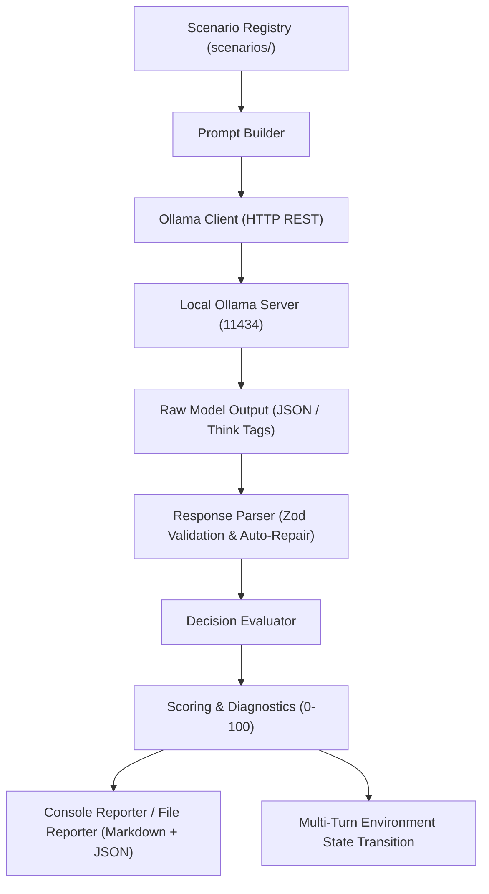

# 🧠 Decision LLM Simulator

A simulation, evaluation, and benchmarking engine for **Decision-Making Large Language Models** (e.g., `tev1:0.8b`, `llama3.2`, `qwen3.5`, `deepseek-r1`) built with **TypeScript**, **Zod**, and local **Ollama**.

---

## 🌟 Highlights

- **Strict Schema Enforcement via Zod**: Enforces structured decision contracts including thought process, action selection, parameters, confidence rating, calibrated risk level, rejected alternatives, and contingency plans.
- **Resilient Output Parsing & Auto-Repair**: Automatic extraction and cleaning of markdown fences, `<think>...</think>` reasoning tags, and intelligent auto-repair of truncated JSON responses.
- **Automated Rule & Constraint Auditing**: Evaluates hard and soft operational constraints, penalizing catastrophic safety violations and scoring goal alignment, risk calibration, and reasoning depth.
- **Dynamic Multi-Turn Environments**: Interactive incident response simulator (`IncidentManagementEnvironment`) where model actions drive real-time environmental state transitions over consecutive turns.
- **Cross-Model Benchmarking**: Compare multiple local Ollama models across high-stakes operational scenarios with automated Markdown and JSON reporting.
- **Production-Ready CLI & SDK**: Rich terminal tables, spinners, and structured outputs for both interactive command-line use and programmatic TypeScript integration.

---

## 🏗️ Architecture



---

## 📦 Tech Stack

- **Runtime**: Node.js >= 22.x (native ESM)
- **Language**: TypeScript 5.8
- **Schema Validation**: Zod 3.24
- **LLM Engine**: Ollama (local API)
- **CLI Framework**: Commander.js + Chalk + Ora + Cli-Table3
- **Test Framework**: Vitest (100% passing test suite)
- **Linting & Formatting**: ESLint (v9 flat config) + Prettier

---

## 🚀 Quick Start

### 1. Prerequisites

Ensure [Ollama](https://ollama.com) is running locally and at least one model is downloaded:

```bash
# Check Ollama status
curl http://localhost:11434/api/tags

# Pull recommended lightweight decision models if needed
ollama pull llama3.2:latest
# or
ollama pull tev1:0.8b
```

### 2. Installation

```bash
git clone <repository-url>
cd decision-llm-simulator
npm install
npm run build
```

### 3. Running the Simulator

#### Discover Local Models & Capabilities

```bash
npx tsx src/cli.ts list-models
# or after build:
node dist/cli.js list-models
```

#### List Available Scenarios

```bash
node dist/cli.js list-scenarios
```

#### Run a Single Scenario Simulation

```bash
# Run database failover scenario with llama3.2
node dist/cli.js run incident_database_failover --model llama3.2:latest --save

# Run UAV route replanning scenario
node dist/cli.js run drone_route_replanning --model llama3.2:latest
```

#### Run a Multi-Turn Interactive Environment

```bash
# Simulates a dynamic incident response scenario over consecutive turns
node dist/cli.js env --model llama3.2:latest
```

#### Run a Comparative Benchmark Matrix

```bash
# Benchmark models across scenarios and output comparison report
node dist/cli.js benchmark --models "llama3.2:latest,tev1:0.8b" --scenarios all
```

---

## 📋 Built-in Scenarios

| Scenario ID                    | Title                                              | Domain                 | Key Hard Constraint                                              |
| :----------------------------- | :------------------------------------------------- | :--------------------- | :--------------------------------------------------------------- |
| `incident_database_failover`   | Critical Database Failover Under Peak Traffic      | Infrastructure / SRE   | Zero committed data loss (no uncoordinated force failover)       |
| `disaster_relief_logistics`    | Emergency Flood Relief Resource Allocation         | Humanitarian Logistics | Max 1,200L fuel reserve, no night flights in degraded visibility |
| `drone_route_replanning`       | Autonomous UAV Route Replanning in Severe Storm    | Robotics & Aviation    | Prohibited military airspace (Zone R-4402), 8% battery reserve   |
| `cyber_ransomware_containment` | Active Ransomware Containment in Financial Network | Cybersecurity          | Continuous uptime for RTGS wire settlement gateway               |

---

## 🧪 Testing & Validation

Run the test suite, linting, and build validation (per `AGENT.md` governance):

```bash
# Run unit and integration tests
npm test

# Run ESLint
npm run lint

# Check formatting
npm run format:check

# Compile TypeScript
npm run build
```

---

## 📜 Governance & Workflow

This repository strictly enforces **Issue-Driven Development** and atomic feature branches:

- See [`AGENT.md`](./AGENT.md) for branch naming (`feature/<name-of-feature>`), commit conventions, and Definition of Done (DoD).

---

## 📄 License

MIT © decision-llm-simulator contributors
