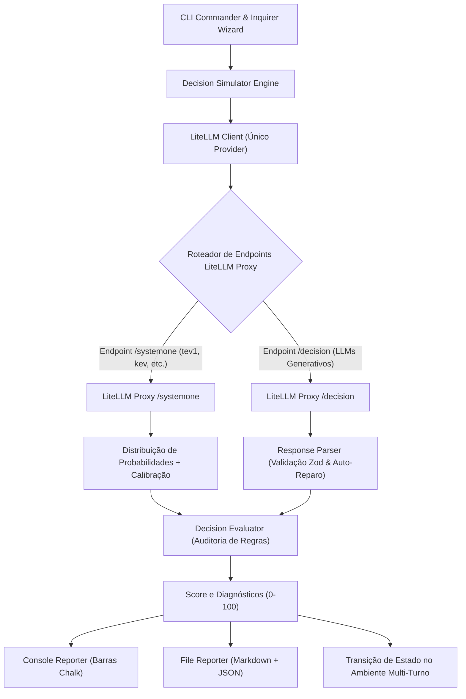

# 🧠 Simulador de Modelos de Decisão (Decision LLM Simulator)

Motor de simulação, avaliação e benchmarking para **Modelos de Linguagem Focados em Tomada de Decisão** utilizando **LiteLLM Proxy** como provedor único e unificado de modelos, desenvolvido com **TypeScript**, **Zod**, **Commander**, **Inquirer** e **Chalk**.

---

## 🌟 Destaques do Projeto

- **LiteLLM Proxy como Único Provedor de Modelos**: Centralização total de chamadas LLM e modelos de decisão através do gateway LiteLLM Proxy (`http://localhost:4000`), suportando balanceamento de carga, governança, autenticação e auditoria unificada.
- **Roteamento Nativo Dual: `/decision` e `/systemone`**:
  - **`/decision`**: Inferência estruturada para LLMs generativos (ex: `gpt-4o`, `claude-3-5-sonnet`, `llama-3.3`, `gemini-1.5-pro`) com validação de schemas estritos Zod.
  - **`/systemone` (e `/sytemone`)**: Inferência ultrarrápida para modelos probabilísticos nativos de decisão (ex: `tev1:0.8b`, `tev1:4b`, `kev`, `nimble`), com cálculo calibrado de probabilidades e sem tokens descartáveis.
- **Assistente Interativo Completo com Inquirer & Chalk**: Modo interativo (`decision-sim interactive` ou execução sem parâmetros) com menu guiado para seleção amigável de cenários, modelos do proxy, rotas de endpoint, ajuste de temperatura e execução em tempo real.
- **Distribuição Probabilística de Ações Calibrada**: Renderização visual em barras no terminal das distribuições de probabilidade de cada ação candidata, confiança percentual e plano de contingência baseado na segunda melhor alternativa residual.
- **Contratos Estritos com Zod**: Validação robusta de saídas estruturadas contendo ação escolhida, justificativa de risco, processo de raciocínio passo a passo, estimativa de confiança, alternativas descartadas e plano de contingência.
- **Parser Resiliente com Auto-Reparo**: Extração inteligente de blocos de pensamento `<think>...</think>`, markdown code fences e reparo automático de JSONs truncados por limite de tokens.
- **Auditoria de Regras e Restrições**: Verificação automática de restrições rígidas (_hard constraints_) e suaves (_soft constraints_), aplicando penalidades a violações catastróficas e pontuando calibração de risco e otimalidade (0 a 100).
- **Ambiente Dinâmico Multi-Turno**: Simulação de resposta a incidentes (`IncidentManagementEnvironment`) onde as ações do modelo impactam diretamente a telemetria (saúde do cluster, erros de checkout, orçamento e satisfação) ao longo de turnos sucessivos.
- **Benchmarking Comparativo entre Modelos**: Execução de matrizes de testes comparando modelos com relatórios detalhados em Markdown e JSON salvos em `reports/`.

---

## 🏗️ Arquitetura



---

## 📦 Stack Tecnológica

- **Runtime**: Node.js >= 22.x (ESM nativo)
- **Linguagem**: TypeScript 5.8
- **Validação de Schemas**: Zod 3.24
- **Model Provider Único**: LiteLLM Proxy (`http://localhost:4000`) com endpoints `/decision` e `/systemone`
- **CLI & Interatividade**: Commander.js + Inquirer.js + Chalk + Ora + Cli-Table3
- **Test Runner**: Vitest (100% de aprovação)
- **Padronização de Código**: ESLint (v9 flat config) + Prettier

---

## 🚀 Guia de Início Rápido

### 1. Configuração do LiteLLM Proxy

Certifique-se de que o LiteLLM Proxy está ativo (por padrão em `http://localhost:4000`). Você pode configurar as seguintes variáveis de ambiente no seu arquivo `.env`:

```env
LITELLM_HOST=http://localhost:4000
LITELLM_API_KEY=sua-chave-opcional
LITELLM_MODEL=decision-model
```

### 2. Instalação e Compilação

```bash
git clone <url-do-repositorio>
cd decision-llm-simulator
npm install
npm run build
```

### 3. Executando o Simulador

#### Modo Interativo Guiado (Inquirer + Chalk)

Basta executar o comando sem argumentos ou com `interactive`:

```bash
npm run sim
# ou
npm run sim -- interactive
```

#### Listar Modelos Configurados no LiteLLM Proxy

```bash
npm run sim -- list-models
```

#### Listar Cenários Operacionais Disponíveis

```bash
npm run sim -- list-scenarios
```

#### Executar Simulação via Endpoint `/decision` ou `/systemone`

```bash
# Execução padrão (detecção automática de endpoint por modelo)
npm run sim -- run incident_database_failover gpt-4o-mini --save

# Forçando o endpoint /systemone para modelos de decisão probabilísticos
npm run sim -- run incident_database_failover tev1:0.8b -e systemone --save

# Forçando o endpoint /decision para modelos generativos com structured output
npm run sim -- run incident_database_failover decision-model -e decision --save
```

#### Executar Simulação de Ambiente Dinâmico Multi-Turno

```bash
npm run sim -- env -m decision-model
```

#### Executar Matriz de Benchmark Comparativo

```bash
npm run sim -- benchmark decision-model,tev1:0.8b all
```

---

## 📋 Cenários Integrados

| ID do Cenário                  | Título                                                  | Domínio               | Restrição Rígida Principal                                                       |
| :----------------------------- | :------------------------------------------------------ | :-------------------- | :------------------------------------------------------------------------------- |
| `incident_database_failover`   | Failover Crítico de Banco de Dados sob Tráfego de Pico  | Infraestrutura / SRE  | Tolerância zero à perda de dados (proibido failover forçado sem sincronização)   |
| `disaster_relief_logistics`    | Alocação de Recursos em Emergência de Inundação         | Logística Humanitária | Limite máximo de 1.200L de combustível; proibido voo noturno sob clima degradado |
| `drone_route_replanning`       | Replanejamento Autônomo de Rota de Drone sob Tempestade | Robótica & Aviação    | Espaço aéreo militar proibido (Zona R-4402); reserva mínima de 8% de bateria     |
| `cyber_ransomware_containment` | Contenção Ativa de Ransomware em Rede Bancária          | Cibersegurança        | Manter operação ininterrupta do gateway RTGS de liquidação bancária              |

---

## 🧪 Validação e Testes

Todos os comandos de validação do projeto (definidos em [`AGENT.md`](./AGENT.md)) garantem integridade total com **exit code 0**:

```bash
# Executar suíte de testes unitários e de integração
npm test

# Verificação estática de tipos e compilação
npm run build

# Análise de linting
npm run lint

# Verificação de formatação de código
npm run format:check
```

---

## 📜 Governança e Fluxo de Desenvolvimento

Este repositório adota **Desenvolvimento Orientado a Issues** e branches atômicas:

- Consulte o [`AGENT.md`](./AGENT.md) para detalhes de convenção de branches (`feature/<name-of-feature>`), commits semânticos e Critérios de Aceite (DoD).

---

## 📄 Licença

MIT © decision-llm-simulator contributors
