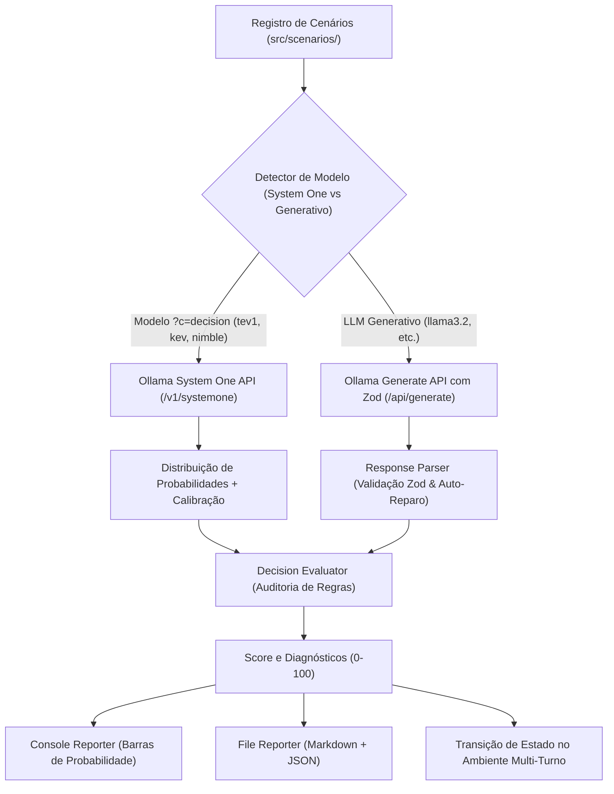

# 🧠 Simulador de Modelos de Decisão (Decision LLM Simulator)

Motor de simulação, avaliação e benchmarking para **Modelos de Linguagem Focados em Tomada de Decisão** (ex: `tev1:0.8b`, `llama3.2`, `qwen3.5`, `deepseek-r1`) desenvolvido com **TypeScript**, **Zod** e **Ollama**.

---

## 🌟 Destaques do Projeto

- **Suporte Nativo a Modelos de Decisão Ollama (`?c=decision`)**: Integração direta com a API nativa System One (`/v1/systemone`) do Ollama para modelos especializados em classificação de decisão (ex: `tev1:0.8b`, `tev1:4b`, `kev`, `nimble`, `clef`, etc.), permitindo inferência ultra-rápida (~200ms vs ~13s) com 0 tokens de geração dispersa.
- **Distribuição Probabilística de Ações Calibrada**: Renderização em barras visuais no terminal da distribuição de probabilidade de cada ação candidata, confiança percentual e plano de contingência baseado na segunda melhor alternativa residual.
- **Compatibilidade Dual (System One + LLMs Generativos)**: Roteamento inteligente que executa modelos de decisão via `/v1/systemone` ou LLMs generativos (`llama3.2`, `qwen`, `deepseek`) via `/api/generate` com Structured Outputs Zod.
- **Contratos Estritos com Zod**: Validação robusta de saídas estruturadas contendo ação escolhida, justificativa de risco, processo de raciocínio passo a passo, estimativa de confiança, alternativas descartadas e plano de contingência.
- **Parser Resiliente com Auto-Reparo**: Extração inteligente de blocos de pensamento `<think>...</think>`, markdown code fences e reparo automático de JSONs truncados por limite de tokens.
- **Auditoria de Regras e Restrições**: Verificação automática de restrições rígidas (_hard constraints_) e suaves (_soft constraints_), aplicando penalidades a violações catastróficas e pontuando calibração de risco e otimalidade (0 a 100).
- **Ambiente Dinâmico Multi-Turno**: Simulação de resposta a incidentes (`IncidentManagementEnvironment`) onde as ações do modelo impactam diretamente a telemetria (saúde do cluster, erros de checkout, orçamento e satisfação) ao longo de turnos sucessivos.
- **Benchmarking Comparativo entre Modelos**: Execução de matrizes de testes comparando modelos locais com geração de relatórios detalhados em Markdown e JSON salvos em `reports/`.
- **CLI Interativa & SDK Modular**: Interface de linha de comando com tabelas, spinners e cores via Commander, Chalk e Ora, além de exportação modular como biblioteca TypeScript.

---

## 🏗️ Arquitetura



---

## 📦 Stack Tecnológica

- **Runtime**: Node.js >= 22.x (ESM nativo)
- **Linguagem**: TypeScript 5.8
- **Validação de Schemas**: Zod 3.24
- **Engine de IA**: Ollama API local (`http://localhost:11434`) com endpoints `/v1/systemone` e `/api/generate`
- **CLI & Visualização**: Commander.js + Chalk + Ora + Cli-Table3
- **Test Runner**: Vitest (100% de aprovação)
- **Padronização de Código**: ESLint (v9 flat config) + Prettier

---

## 🚀 Guia de Início Rápido

### 1. Pré-requisitos

Certifique-se de que o [Ollama](https://ollama.com) está em execução localmente e possui ao menos um modelo baixado:

```bash
# Verificar se o Ollama está ativo
curl http://localhost:11434/api/tags

# Baixar modelo nativo de decisão (categoria ?c=decision)
ollama pull tev1:0.8b

# Opcional: baixar modelo generativo para comparação
ollama pull llama3.2:latest
```

### 2. Instalação e Compilação

```bash
git clone <url-do-repositorio>
cd decision-llm-simulator
npm install
npm run build
```

### 3. Executando o Simulador

#### Listar Modelos Instalados e Detecção de Capacidade de Decisão

```bash
npm run sim -- list-models
# ou
node dist/cli.js list-models
```

#### Listar Cenários Disponíveis

```bash
npm run sim -- list-scenarios
```

#### Executar Simulação com Modelo de Decisão Nativo (tev1:0.8b)

```bash
# Simula o cenário e exibe gráfico de barras da distribuição probabilística de ações
npm run sim -- run incident_database_failover tev1:0.8b --save
```

#### Executar Simulação de Ambiente Dinâmico Multi-Turno

```bash
# O modelo enfrenta uma crise operacional durante turnos interativos
npm run sim -- env -m tev1:0.8b
```

#### Executar Matriz de Benchmark Comparativo (System One vs LLM Generativo)

```bash
# Compara o modelo de decisão rápido (tev1:0.8b) contra o LLM generativo (llama3.2)
npm run sim -- benchmark tev1:0.8b,llama3.2:latest all
```

---

## 📋 Cenários Integrados

| ID do Cenário                  | Título                                                  | Domínio               | Restrição Rígida Principal                                                       |
| :----------------------------- | :------------------------------------------------------ | :-------------------- | :------------------------------------------------------------------------------- |
| `incident_database_failover`   | Failover Crítico de Banco de Dados sob Tráfego de Pico  | Infraestrutura / SRE  | Tolerância zero à perda de dados (proibido failover forçado sem sincronização)   |
| `disaster_relief_logistics`    | Alocação de Recursos em Emergência de Inundação         | Logística Humanitária | Limite máximo de 1.200L de combustível; proibido voo noturno sob clima degradado |
| `drone_route_replanning`       | Replanejamento Autônomo de Rota de Drone sob Tempestade | Robótica & Aviação    | Espaço aéreo militar proibido (Zona R-4402); reserva mínima de 8% de bateria     |
| `cyber_ransomware_containment` | Contenção Ativa de Ransomware em Rede Bancária          | Cibersegurança        | Manter operação ininterrupta do gateway RTGS de liquidação bancária              |

---

## 🧪 Validação e Testes

Todos os comandos de validação do projeto (definidos em [`AGENT.md`](./AGENT.md)) garantem integridade total com **exit code 0**:

```bash
# Executar suíte de testes unitários e de integração
npm test

# Verificação estática de tipos e compilação
npm run build

# Análise de linting
npm run lint

# Verificação de formatação de código
npm run format:check
```

---

## 📜 Governança e Fluxo de Desenvolvimento

Este repositório adota **Desenvolvimento Orientado a Issues** e branches atômicas:

- Consulte o [`AGENT.md`](./AGENT.md) para detalhes de convenção de branches (`feature/<name-of-feature>`), commits semânticos e Critérios de Aceite (DoD).

---

## 📄 Licença

MIT © decision-llm-simulator contributors
